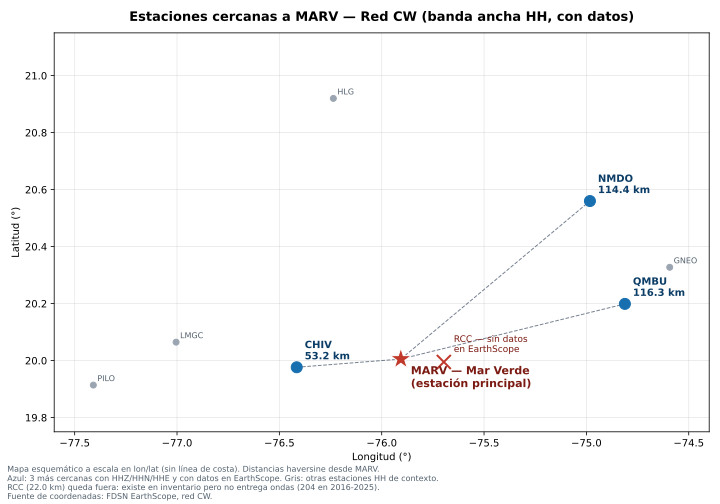

Dataset de Ondas P — Red Sísmica Cubana (CW)
Herramientas y scripts para la descarga, procesamiento y estructuración de registros de ondas P utilizando datos de estaciones sismológicas de la red cubana (CW) a través de FDSN y SeisBench.

## Corrección 2026-11-03: verificación de estaciones y clasificación

1. **¿Cómo se clasifica ruido o sismo?** El script de descarga NO
   clasifica. Extrae los 3 canales y guarda MiniSEED, nada más. La
   etiqueta se asigna en un paso separado, con el criterio explícito
   en `clasificacion_ruido_sismo.py`: una ventana es **sismo** si
   contiene la llegada P de un evento del catálogo; es **ruido** si
   no contiene llegada P y no hay ningún evento del catálogo dentro
   de una zona de seguridad de 60 minutos alrededor; y es
   **sin_etiqueta** si no hay catálogo ni llegada P que la respalde.
   Sin evidencia, no se inventa etiqueta y esa ventana no entra al
   entrenamiento.
2. **¿Qué estaciones son las cercanas y con qué criterio?** Solo
   cuentan las estaciones CW con los 3 canales HHZ/HHN/HHE activos
   en la ventana de trabajo, ordenadas por distancia haversine desde
   RCC. Para 2023-10-15, las 3 primeras son MARV, CHIV y QMBU. El
   cálculo reproducible está en `estaciones_cercanas.py`.
   La lista anterior (MOAC, TGU, CEN) no cumple ese criterio en
   FDSN/CW para esa fecha: MOAC está a 107.4 km y en esa ventana
   solo tiene canales EH y HN, no HH; TGU y CEN no aparecen como
   códigos CW en esa consulta. Por eso se corrige la lista, no se
   mantiene porque "la IA lo dijo".
3. **Mapa de las estaciones cercanas:**

Mapa esquemático a escala en longitud/latitud (sin línea de costa).
RCC es la estación principal; en azul, las 3 más cercanas con HH
activas; en gris, otras estaciones HH de contexto.

| Estación | Lugar | Distancia desde RCC |
|---|---|---|
| MARV | Mar Verde, Santiago de Cuba | 22.0 km |
| CHIV | Chivirico, Guamá, Santiago de Cuba | 75.1 km |
| QMBU | Quimbuelo, San Antonio del Sur, Guantánamo | 95.1 km |

Coordenadas verificadas en el servicio FDSN de IRIS/EarthScope, red
CW, para 2023-10-15. RCC: 19.995001, -75.696503.

## Actualización 2026-11-05: catálogo NEIC/USGS

- Las formas de onda y los metadatos de estaciones siguen en FDSN/EarthScope, red CW.
- El catálogo de eventos ya no se pide a EarthScope: EarthScope retiró su servicio FDSN de eventos el 1 de junio de 2026 y recomienda ISC y NEIC como reemplazos.
- El catálogo usado ahora es NEIC/USGS por FDSN (`Client("USGS")`, https://earthquake.usgs.gov/fdsnws/event/1/). En la misma búsqueda verificada (2020-2024, radio 3° alrededor de RCC) NEIC/USGS devuelve 122 eventos e ISC 107.
- El cuaderno `dataset_eqt_colab.ipynb` (Drive/Colab, mismo enlace) ya usa ese catálogo; en periodos largos solo descarga segmentos de 7 minutos alrededor de cada evento, no años continuos.
- Las estaciones y el mapa no cambian: RCC, MARV (22.0 km), CHIV (75.1 km), QMBU (95.1 km).

## Entrenamiento y evaluación (trabajo en paralelo, sin números inventados)

La guía para el Elevator Pitch está en `docs/guia_elevator_pitch.md`.
Antes de presentar resultados del modelo hay que cumplir: dividir
por evento (no mezclar ventanas del mismo sismo en entrenamiento y
prueba), reportar matriz de confusión además de exactitud, comparar
contra una línea base simple y guardar qué catálogo y qué llegada P
respalda cada etiqueta. Hasta que esas métricas existan de verdad,
el resultado del modelo queda como pendiente, no como afirmación.

📁 Estructura del Proyecto
dataset-ondas-p-cw/
├── config/             # Archivos de configuración (JSON)
├── data/               # Datos brutos y procesados (fases, trazas)
├── docs/               # Documentación y notas técnicas
├── notebooks/          # Notebooks de Jupyter / Google Colab
├── resultados/         # Gráficas, métricas y salidas de modelos
├── src/                # Código fuente principal (scripts de Python)
├── tests/              # Pruebas unitarias y de integración
├── INFORME_FINAL.md    # Reporte y conclusiones del proyecto
├── README.md           # Este archivo
└── requirements.txt    # Dependencias del proyecto

⚙️ Configuración (config/configuracion.json)
El proyecto utiliza un archivo de configuración centralizado para definir los parámetros de extracción y procesamiento:
 * Estación principal: RCC (Río Carpintero, Santiago de Cuba)
 * Estaciones prioritarias: ['RCC', 'QMBU', 'MARV', 'LMGC', 'CHIV', 'GTMO']
 * Frecuencia de muestreo: Estandarizada a 100 Hz
 * Límites de ventana temporal: Configurables por corrida (por defecto para pruebas en rangos específicos de alta sismicidad).
🚀 Instalación y Uso
 * Clonar el repositorio:
   git clone https://github.com/tu-usuario/dataset-ondas-p-cw.git
cd dataset-ondas-p-cw

 * Instalar las dependencias:
   Se recomienda utilizar un entorno virtual de Python (versión 3.10 o superior).
   pip install -r requirements.txt

 * Ejecución en Google Colab / Local:
   Puedes abrir y ejecutar el flujo completo de extracción en el notebook ubicado en notebooks/dataset_eqt_colab.ipynb, el cual gestiona automáticamente la conexión con FDSN (EarthScope/IRIS) y el almacenamiento estructurado en Google Drive.
🛠️ Dependencias Principales
 * ObsPy (>= 1.5.0) — Procesamiento de datos sismológicos y manejo de metadatos SEED/FDSN.
 * SeisBench (>= 0.12.0) — Herramientas de aprendizaje automático para sismología.
 * Pandas / NumPy — Manipulación y análisis de datos tabulares y numéricos.
